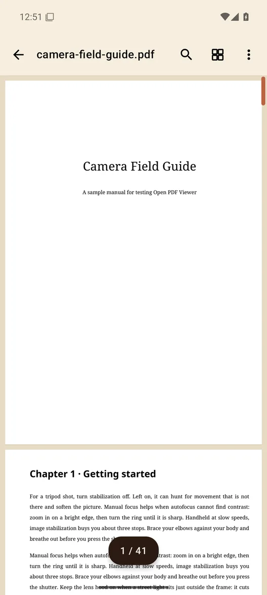
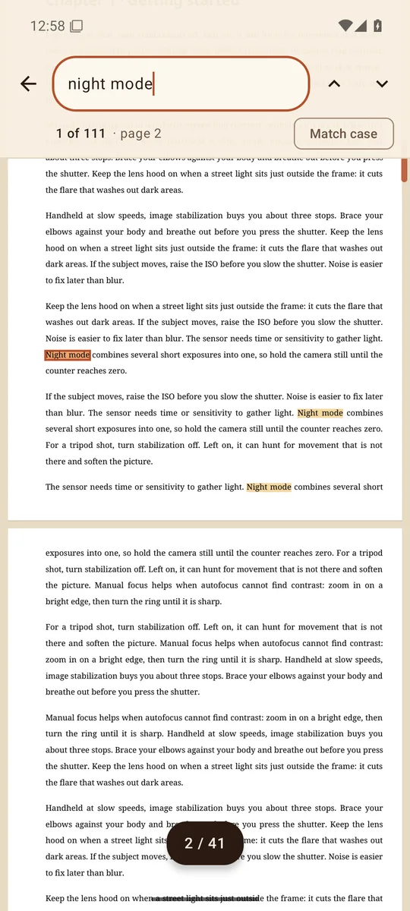
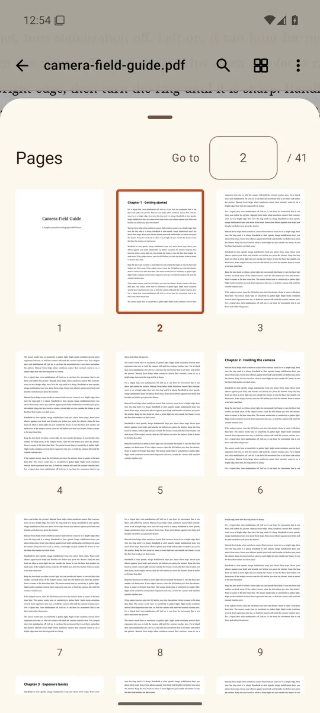

<h1 align="center">Open PDF Viewer</h1>

<p align="center">
  A PDF viewer for Android that only views. Free and open source, with no ads, no account and no
  internet: open a PDF, read it, search it, copy from it.
</p>

<p align="center">
  <a href="https://github.com/guilhermefeitosa66/open-pdf-viewer/releases/latest"></a>
  &nbsp;
  <a href="LICENSE"></a>
</p>

<p align="center">
  
  
  
  
</p>

Part of [libre-apps](https://libre-apps.org), alongside OpenEmux, OpenTuner and SLAP.

## What it does (v0.1)

- Continuous vertical scrolling, page indicator, fast-scroll handle, go to page.
- Pinch and double-tap zoom, fit width / fit page. Zoomed pages are re-rendered sharp.
- Search in the text with highlights, next/previous, match count and a match-case toggle.
- Long-press to select text, drag the handles, copy or share.
- Page thumbnails in a bottom sheet.
- Recent files with the page where you stopped.
- Opens from the file picker, "Open with" and Share. Password-protected PDFs are supported.
- Themes: libre-apps (follows the system light/dark setting, the default), Pastel, Dracula, Kitty
  and Neon (Tokyo Night), with an optional background image on the home screen and behind the bars.
  The document always sits on a solid color.
- English, Portuguese and Spanish.

What comes next is in [docs/roadmap.md](docs/roadmap.md): reading comfort, annotations, page
organization, forms and signatures, compression. Everything local.

## Privacy

The app has no `INTERNET` permission and no storage permission. Files reach it only through the
Android file picker or another app's "Open with" / Share, and nothing leaves the device.

## Install

Android 8.0 or newer. Download the APK from the
[latest release](https://github.com/guilhermefeitosa66/open-pdf-viewer/releases/latest).
"Coming soon to Google Play."

## Build

Requirements: JDK 17, Android SDK 36, NDK 28.2 and CMake 3.22 (installed by Android Studio's SDK
Manager).

```bash
tools/fetch-pdfium.sh          # downloads the pinned PDFium binaries (checked by SHA-256)
./gradlew :app:assembleDebug   # app/build/outputs/apk/debug/app-debug.apk
./gradlew :app:testDebugUnitTest
```

`tools/sync-themes.py` copies the shared libre-apps themes into `app/src/main/assets/themes/`
(run it when the themes change, then commit).

`./gradlew :app:assembleBenchmark` builds release code signed with the debug key, for measuring
start-up on a device.

## How it works

Pages are rendered by [PDFium](https://pdfium.googlesource.com/pdfium/), the engine of Chrome,
through a small JNI layer in the `pdfium` module. The reasons for this choice, and why not the
platform `PdfRenderer` or `androidx.pdf`, are in [docs/plan.md](docs/plan.md).

## Dependencies and licenses

The app is licensed under the [Apache License 2.0](LICENSE).

| Dependency | License |
|---|---|
| [PDFium](https://pdfium.googlesource.com/pdfium/) | BSD-3-Clause / Apache-2.0 |
| [pdfium-binaries](https://github.com/bblanchon/pdfium-binaries) (prebuilt PDFium, `chromium/8179`) | MIT |
| Libraries bundled inside PDFium (FreeType, HarfBuzz, ICU, libjpeg-turbo, libpng, OpenJPEG, Little CMS, zlib, Abseil and others) | Permissive; full texts in the app under About › Open-source licenses |
| Dracula and Tokyo Night color palettes (in the Dracula and Neon themes) | MIT |
| Pastel and Kitty palettes, all background art ([libre-apps themes](https://libre-apps.org)) | libre-apps, original work |
| Kotlin, kotlinx.coroutines | Apache-2.0 |
| AndroidX (core, activity, lifecycle), Jetpack Compose, Material 3 | Apache-2.0 |
| JUnit (tests only) | EPL-1.0 |
| org.json (tests only) | Public domain |
