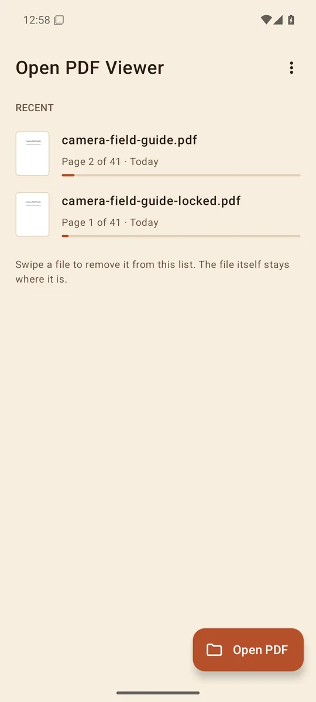
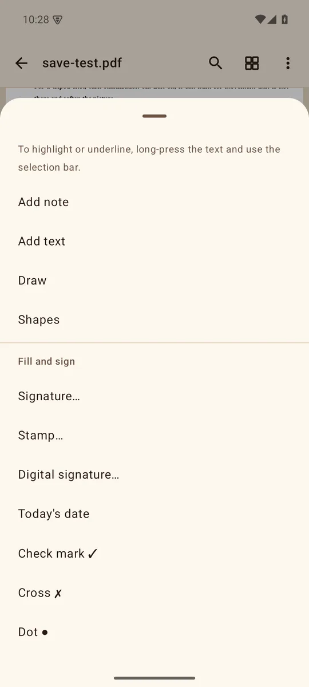
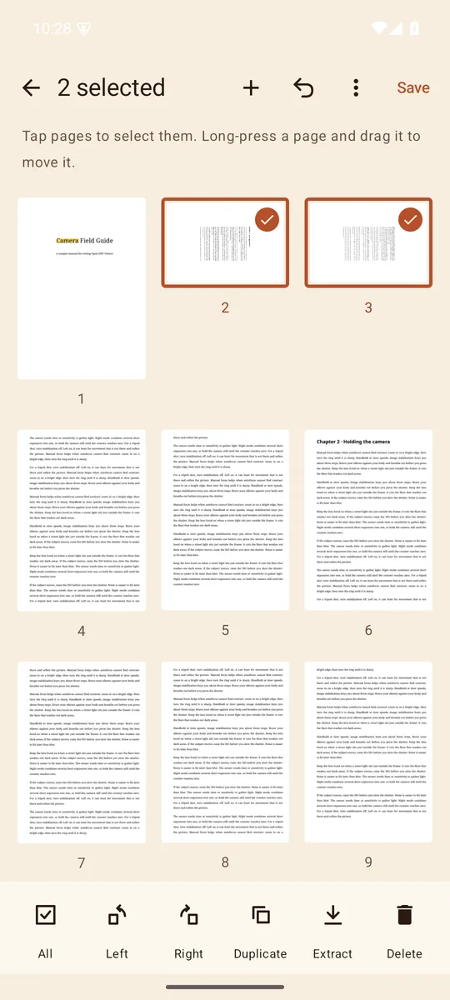
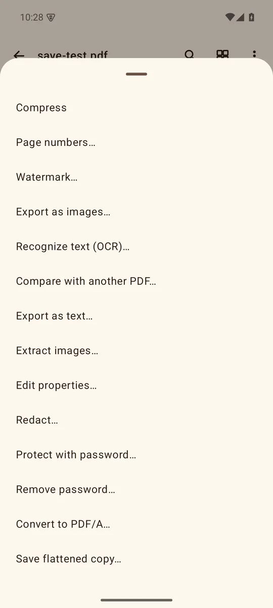
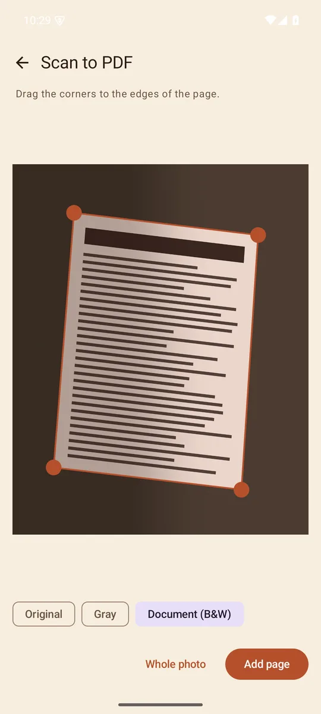

<h1 align="center">Open PDF Viewer</h1>

<p align="center">
  A PDF reader and toolkit for Android. Free and open source, with no ads, no account and no
  internet: read, annotate, fill and sign, organize pages, convert, compress, scan and OCR, all on
  the phone.
</p>

<p align="center">
  <a href="https://github.com/guilhermefeitosa66/open-pdf-viewer/releases/latest"></a>
  &nbsp;
  <a href="LICENSE"></a>
</p>

<p align="center">
  
  
  
  
  
  
</p>

Part of [libre-apps](https://libre-apps.org), alongside OpenEmux, OpenTuner and SLAP.

## What it does

**Read**
- Continuous scrolling or page by page (two pages side by side on tablets and in landscape,
  right-to-left too), pinch and double-tap zoom, fit width or page, go to page, fast scroll.
- Search with highlights, a results list and match case / whole word / accent options; select text
  across pages and copy or share it.
- Table of contents, internal and external links (with a "back" chip), your own bookmarks,
  document info, read aloud with the system voice, print.
- Night and sepia page modes, keep screen on, lock rotation, full screen, and the libre-apps themes.
- Recent files with the page where you stopped, favorites and folders.

**Annotate, fill and sign** (the file changes only when you save; undo and redo)
- Highlight, underline, strike out; free-hand ink; notes; text boxes; shapes; a list of all
  annotations.
- Fill PDF forms (text, check boxes, radio buttons, lists); fill and sign any page with today's
  date, ✓, ✗ and dots.
- Visual signatures (drawn or from a photo, kept on the device) and stamps (ready-made or your own).
- Digital signatures with your certificate (PAdES), and an offline check of the signatures in a file.

**Organize pages**
- Delete, rotate, reorder (drag), duplicate; insert blank pages or pages from another PDF.
- Extract pages, split (every N pages, by ranges, one file per page, up to a file size), merge
  several PDFs (protected ones too), crop margins with white-margin detection.

**Convert and optimize** (Tools…)
- Compress with a size preview; images to PDF; pages as PNG or JPEG; extract embedded images;
  plain text or Markdown.
- Page numbers; text or image watermarks; edit properties and remove hidden metadata.
- Protect with a password (AES-256) or remove it; PDF/A-2b (best effort); flattened copy; repair
  damaged files.

**Scan, OCR, compare, redact**
- Scan to PDF with the system camera app or the gallery: page detection, perspective correction,
  black-and-white document filter.
- Offline OCR (Portuguese and English) that adds an invisible text layer, so scans can be searched
  and copied.
- Compare the text of two PDFs page by page.
- Real redaction: what is under the black boxes is removed from the file, and the app checks it.

Everything runs on the device. What is not here, and why, is in [docs/roadmap.md](docs/roadmap.md).
English, Portuguese and Spanish.

## Privacy

The app has no `INTERNET` permission and no storage permission. Files reach it only through the
Android file picker or another app's "Open with" / Share, and nothing leaves the device.

## Install

Android 8.0 or newer. Download the APK from the
[latest release](https://github.com/guilhermefeitosa66/open-pdf-viewer/releases/latest).
"Coming soon to Google Play."

## Build

Requirements: JDK 17, Android SDK 36, NDK 28.2 and CMake 3.22 (installed by Android Studio's SDK
Manager).

```bash
tools/fetch-pdfium.sh          # downloads the pinned PDFium binaries (checked by SHA-256)
tools/fetch-tessdata.sh        # downloads the pinned OCR models (eng, por; checked by SHA-256)
./gradlew :app:assembleDebug   # app/build/outputs/apk/debug/app-debug.apk
./gradlew :app:testDebugUnitTest
```

`tools/sync-themes.py` copies the shared libre-apps themes into `app/src/main/assets/themes/`
(run it when the themes change, then commit).

`./gradlew :app:assembleBenchmark` builds release code signed with the debug key, for measuring
start-up on a device.

## How it works

Pages are rendered by [PDFium](https://pdfium.googlesource.com/pdfium/), the engine of Chrome,
through a small JNI layer in the `pdfium` module. The reasons for this choice, and why not the
platform `PdfRenderer` or `androidx.pdf`, are in [docs/plan.md](docs/plan.md).

Annotations, forms, page changes, split and merge also go through PDFium. Tools PDFium does not
cover (re-encoding images, AES-256 passwords, metadata, PDF/A, watermarks, text export, digital
signatures) use [PdfBox-Android](https://github.com/TomRoush/PdfBox-Android), loaded only when
one of them runs, so opening a file stays as fast as before. OCR uses Tesseract with the models
packaged in the app. Every tool writes a new version of the file and only replaces the original
when you choose Save.

## Size

Offline OCR is the largest part of the app. Measured on 0.47.0 (release build, all three ABIs):
the universal APK is about 50 MB, of which about 22 MB are Tesseract's native libraries (about
7 MB per ABI) and 6 MB the `eng` and `por` models; without OCR it was about 26 MB. Store
installs from the app bundle only download one ABI, so OCR adds about 13 MB on a phone.

## Dependencies and licenses

The app is licensed under the [Apache License 2.0](LICENSE).

| Dependency | License |
|---|---|
| [PDFium](https://pdfium.googlesource.com/pdfium/) | BSD-3-Clause / Apache-2.0 |
| [pdfium-binaries](https://github.com/bblanchon/pdfium-binaries) (prebuilt PDFium, `chromium/8179`) | MIT |
| Libraries bundled inside PDFium (FreeType, HarfBuzz, ICU, libjpeg-turbo, libpng, OpenJPEG, Little CMS, zlib, Abseil and others) | Permissive; full texts in the app under About › Open-source licenses |
| Dracula and Tokyo Night color palettes (in the Dracula and Neon themes) | MIT |
| Pastel and Kitty palettes, all background art ([libre-apps themes](https://libre-apps.org)) | libre-apps, original work |
| Kotlin, kotlinx.coroutines | Apache-2.0 |
| [Tesseract4Android](https://github.com/adaptech-cz/Tesseract4Android) 4.8.0 (OCR; bundles Tesseract, Leptonica, libjpeg-turbo, libpng) | Apache-2.0 (Leptonica BSD-2-Clause, libjpeg-turbo IJG/BSD-3-Clause, libpng PNG license) |
| Tesseract models `eng` and `por` from [tessdata_fast](https://github.com/tesseract-ocr/tessdata_fast) (fetched by `tools/fetch-tessdata.sh`) | Apache-2.0 |
| sRGB ICC profile for PDF/A (`assets/icc/sRGB.icc`, made by `tools/make-srgb-icc.py`) | Apache-2.0, original work |
| [PdfBox-Android](https://github.com/TomRoush/PdfBox-Android) 2.0.27.0 (digital signatures only) | Apache-2.0 |
| [Bouncy Castle](https://www.bouncycastle.org) `bcprov`/`bcpkix-jdk15to18` 1.87 (digital signatures only) | MIT |
| AndroidX (core, activity, lifecycle), Jetpack Compose, Material 3, Material Icons (core and extended) | Apache-2.0 |
| JUnit (tests only) | EPL-1.0 |
| org.json (tests only) | Public domain |
